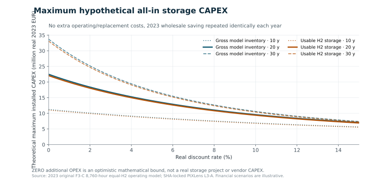
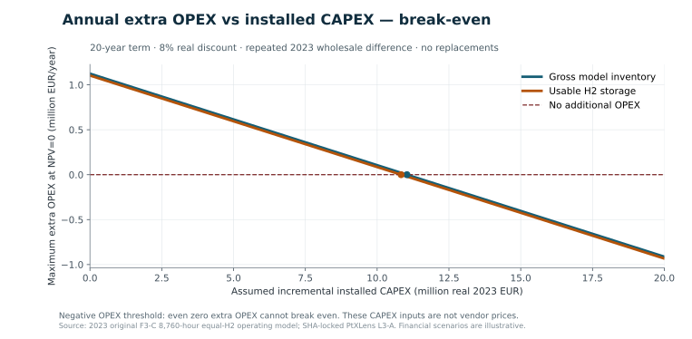
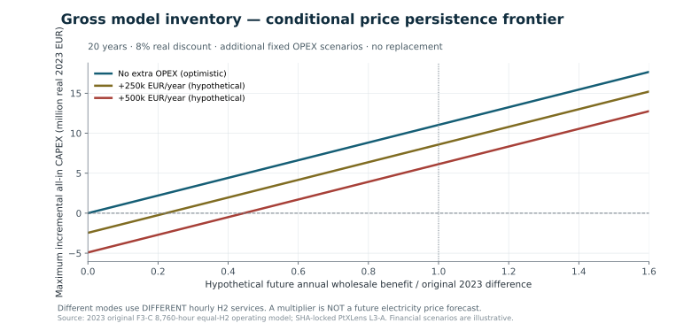
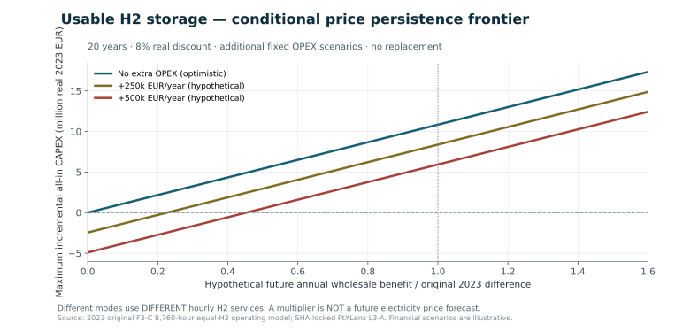

# L3-A — Matched-hour hydrogen storage: source-2023 wholesale electricity saving and discounted break-even capital/operating-cost frontiers

**Programme:** OEM-PTX-2026-01 · **Research checkpoint:** 14 November 2026 · **Source period:** original 2023 PyNEXUS E/E+S, 8,760h historic Dutch A44 electricity-market and ERA5-derived wind model.  
**Status:** **SCIENTIFICALLY REPRODUCIBLE NARROW L3-A CONDITIONAL THRESHOLD MODEL.** Manufacturer-installed storage CAPEX, actual extra OPEX, physical full-plant hydrogen costs, forecast power markets and full native BAFU climate-impact results remain **UNKNOWN/NOT PASSED**. **DO NOT** publish this as an investment recommendation, a full project NPV/LCOH or a prediction of future 2023 wholesale savings.

## 1. Exact question and why the investment comparison remains conditional

For the original pressure-screened source model, a 20-tonne nominal E hydrogen-storage bank and a 40-tonne nominal E+S bank can serve **the same 8,760-hour modelled H₂ product delivery** if the source historic E 2023 hourly delivered reference is reduced by the extra shortfall of one physically screened, *feasible* E Stage-A incumbent. This is the already independently audited **F3-C** result, not newly optimized future hydrogen supply. The E source Stage-A shortfall is **not proven globally minimum**, and neither common service fulfills the historic 18.25-million-kg nominal industrial H₂ contract.

The larger storage bank has a verified, source-modelled **2023 net wholesale grid electricity settlement advantage** at identical hourly H₂ service. F2/L1 has subsequently calculated the associated *reference empty steel Type I pressure-vessel equipment count and mass* at 313 K, 20–200 bar(a), without a manufacturer-certified physical installed bank, materials/process inventory or a commercial quote. Therefore, a real whole-plant life-cycle economics comparison is **inadmissible**.

L3-A asks the explicitly **conditional** break-even question:

> *If*, contrary to any current forecast, the verified 2023 differential wholesale electricity expense were repeated or rescaled in future years; and *if* specified real discount rates, project life, incremental OPEX, replacement events, salvage and decommissioning were realised, **what maximum extra all-in t=0 installed CAPEX would yield zero incremental NPV?** Conversely, for a specified illustrative CAPEX, **what extra annual OPEX would be tolerable?**

The answer is a **frontier or capital ceiling**, not a source-proven storage investment decision. An annual source-savings multiplier is only an **analyst-selected counterfactual**, not a forecast of Dutch day-ahead prices, a future source-verified 8,760h re-optimization, or an equipment-cost quotation. **No nonzero manufacturer station CAPEX or OPEX has been invented.**

### Source evidence and controlled semantics

Two **different** pressure-vessel capacity interpretations define **different** annual/hourly service quantities, and are **never pooled as one functional unit**:

| Frozen F3-C physically screened source quantity | Original gross max-inventory interpretation | Alternative usable-withdrawable interpretation |
|---|---:|---:|
| Original PyNEXUS E reference modelled delivered H₂ | 16,335,279.317 kg/yr | 16,335,279.317 kg/yr |
| Source 200-bar E feasible Stage A additional H₂ shortfall | 66,524.317 kg/yr | 3,720.371 kg/yr |
| **E and E+S same actual 8,760-hour MODELLED delivered H₂** | **16,268,755.001 kg/yr** | **16,331,558.946 kg/yr** |
| Still unmet original full 18.25m kg industrial H₂ contract | **1,981,244.999 kg/yr** | **1,918,441.054 kg/yr** |
| E 2023 net wholesale grid settlement | €25,587,589.630 | €25,880,392.499 |
| E+S 2023 net wholesale grid settlement | €24,463,257.361 | €24,776,928.770 |
| **Source E−E+S wholesale grid saving, 2023 EUR** | **€1,124,332.269** | **€1,103,463.729** |
| Original source 1e-6 relative HiGHS lower/upper saving interval | [€1,124,318.034; €1,124,348.115] | [€1,103,461.954; €1,103,474.625] |
| F2 IJHE Type I 1.8m³/2400kg 313K extra **EMPTY equipment**, not raw steel | 802 extra; 1,924,800 kg empty reference vessels | 902 extra; 2,164,800 kg empty reference vessels |
| Actual installed CAPEX, OPEX, replacement schedules, climate manufacturing inventory | **Unknown / NULL** | **Unknown / NULL** |

**Source lock:** [2023 F3-C signed-hourly operational certificate](../data/results/F3_C_2023_source_real_gas_equal_H2_hour_E_vs_ES_Lens_operational_bridge.json) SHA256 `dddd07d5c0a3d4f276e80af44e28cf3cfdbc93421107fb5d9e39843a0d1d90e2`, independently audited from four original SHA-registered E/ES model cases and their respective Stage-A hourly source shortfall. Its two common-service `float64` SHA256s are gross `8e0d55994c7fe5f1abd952771a1b169336893d12698147fb3a93cb61a4ee7a16`, usable `6a30baf00ddb065cd906dedd711db7cbf67504c50b4fda5809c5dfd29b23fa87`.

[Stationary equipment F2/L1 source-locked Type I reference](../data/results/F2_L1_2023_source_incremental_20t_to_40t_stationary_typeI_200bar_BOM_SCOPE_NOT_complete_native_LCI.json) SHA256 `1315d1181b9d1eab6d3368425c9571dbe295c3360935d2972403bf3c60e2dc47`. A separate manufacturer heiserTEC Type I 330bar PED 50L 85.5kg/cylinder alternative was also audited but **its different rated pressure/geometry and lack of certified 2023 site prohibit combining it with the paper reference or a site CAPEX**. Source F2 has **18 still-unquantified station-equipment/LCI categories**. The original BAFU high-pressure **vehicle composite** tank per kg H₂ capacity is not a stationary Type I steel manufacturing input. [PtXLens L1 manufacturing stop](L1_STATIONARY_TYPEI_OEM_SOURCE_MANUFACTURING_GWP_GATE_v1.md).

The exact [cross-repository economic-evidence manifest](../research/L3_A_2023_source_locked_incremental_wholesale_DCF_handoff_v1.json) records both source hashes, separate capacity semantics, finance scenario knobs, absent supplier/cost fields and prohibited claims. [PtXFlex independently generated source-2023 operating economics handoff](../data/results/L3_A_PtXFlex_2023_source_hourly_equal_service_wholesale_only_financial_handoff.json) SHA256 `0de22f7ff566dc50101b085366e47ef9965d545dca1dfa9bca3dd6d115274829` independently checks source F3-C/F2 evidence with explicit null vendor economics.

## 2. Economic model, units, treatment of inflation and timing

Let `m` denote one (and only one) source bank-capacity interpretation, with source **annual** wholesale saving `S_m = C_E,m(2023) − C_ES,m(2023)` measured in modelled **2023 EUR**. Let `k_t >= 0` be a user/analyst-selected **dimensionless** scenario persistence factor on that *historic model differential*, not an actual hourly-market forecast. The hypothetical annual operating benefit in future year `t` is `B_t = k_t · S_m`.

Define:
- `N`: illustrative years of future operation (integer 1–60 supported by calculator), not a verified vessel design/fatigue lifetime.
- `r`: illustrative **REAL** discount rate (nonnegative in this engine; mathematical domain enforced below 100%/yr, not a supplied industrial WACC).
- `C₀`: hypothetical **all-in incremental installed initial CAPEX** E+S−E, at time zero, in constant-purchasing-power **2023 EUR**. This must eventually include pressure vessels, site material, compression, cooling, civil, electrical and other incremental plant equipment and installation. Actual source value **NULL**.
- `O_t >= 0`: additional annual operations, inspections, cooling electricity, staff, maintenance, warranties, connection or any other physically allocable incremental plant cost in **real EUR2023**, paid **end** of each hypothetical operating year; **source value NULL**.
- `R_t >= 0`: explicitly scheduled replacement investment at the **end** of the indexed operating year; zero in a specific sensitivity means a mathematical no-replacement *assumption*, **not** that replacement is physically unnecessary.
- `V_N >= 0`: hypothetical end-year salvage or terminal residual receipt; `D_N >= 0` end-year decommissioning cost.

The **pre-tax, unlevered, incremental wholesale-only** hypothetical project NPV is:

```text
  Delta NPV_m(C0; k_t,O_t,R_t,V_N,D_N,N,r) =
    - C0 + sum_{t=1 to N} [k_t*S_m - O_t - R_t] / (1+r)^t
         + [V_N - D_N] / (1+r)^N .
```

Zero incremental NPV solved for the **maximum allowable initial all-in installed CAPEX**:

```text
  C0_max(m; assumptions) =
        PV(k_t*S_m)
      - PV(O_t)
      - PV(R_t)
      + PV(V_N)
      - PV(D_N).
```

This is a **conditional maximum**, not the manufacturer's initial installed cost. If `C0_max < 0`, **no nonnegative initial CAPEX can break even** given those *selected* operating and terminal assumptions. A positive `C0_max` does not establish that installing this Type I steel bank costs less than the ceiling.

For a specified illustrative `C0` with **flat OPEX** `O`:

```text
  A(N,r) = sum_{t=1 to N} (1+r)^(-t)
  O_flat,max =
    [PV(k_t*S_m) - PV(R_t) + PV(V_N) - PV(D_N) - C0] / A(N,r).
```

A negative `O_flat,max` means even **zero** extra fixed annual OPEX fails at that hypothetical CAPEX, absent positive additional benefits not covered here.

The source solver's 2023 **deterministic optimum bounds** `S_m,low <= S_m,true <= S_m,high` propagate to a **NUMERICAL computational ceiling interval** `[S_m,low * Σ(k_t·DF_t) + PV(other), S_m,high * Σ(k_t·DF_t) + PV(other)]`, since all `k_t >= 0`. This interval **does not** include market-regime uncertainty, model-form error, price escalation, pressure equipment costs, ageing, delivery reliability, supply shortages, tax effects or real engineering installation-risk uncertainty.

### Real/nominal consistency

The source market quote is **2023 EUR**, treated as the **reference-year constant-purchasing-power EUR** *only for these purely illustrative future schedules*. Discounting constant real 2023-EUR operating cash flows requires a **real** discount rate; it would be wrong to simultaneously inflate them by an assumed 2026 or forward CPI path and discount at an unadjusted real rate. The unit tests independently demonstrate equivalent real and nominal NPVs if the Fisher conversion `(1+i)=(1+r)*(1+inflation)` is applied consistently; no inflation forecast is installed or silently imported.

Methodological references (not source calibration): [U.S. DOE H2A Production Analysis](https://www.hydrogen.energy.gov/program-areas/systems-analysis/h2a-analysis/h2a-production), [U.S. DOE H2A governing equations and cost scope](https://www.energy.gov/cmei/fuels/articles/guidance-filling-out-detailed-h2a-production-case-study), and [ATAP constant-dollar real/nominal treatment](https://www.atap.gov.au/tools-techniques/cost-benefit-analysis/3-step-2-identify-the-benefits-and-costs). **H2A itself provides a full hydrogen selling-price calculation including finance, tax, depreciation, feedstocks, facilities and more. Our L3-A is deliberately narrower, and cannot be called a completed H2A full LCOH/DCF.**

## 3. Analyst-selected sensitivity assumptions — none are manufacturer quotations

The [registered scenario grid](../research/L3_A_2023_source_locked_incremental_wholesale_DCF_handoff_v1.json) is openly a **mathematical what-if analysis**, not an engineering cost forecast:

| Parameter | Hypothetical values | Interpretation |
|---|---|---|
| Lifetime `N` | 5, 10, 15, 20, 25, 30 years | **Illustrative**; source PED pressure-cycle fatigue design not verified |
| Real discount `r` | 0%, 3%, 5%, 8%, 12% | **Sensitivity values**, not bank borrowing cost or source WACC |
| Future source-differential persistence `k` | 0.25, 0.50, 0.75, 1, 1.25, 1.50 | Historical 2023 source annual wholesale advantage scaled hypothetically, **not a future price forecast** |
| Flat incremental OPEX | €0, €250,000, €500,000/year | €0 is **optimistic mathematical envelope**, the others arbitrary stress assumptions; real installed station OPEX absent |
| Replacement stress | No extra or **€1m end of year 10** | Illustrative stress, **not sourced from OEM**; invalid at horizons less than 10 without an explicit year check |
| Terminal salvage and decommission | €0 in displayed reference | Pure **convenience/stress**; no project terminal valuation or recycling price supplied |
| Basic reporting slice | `N=20`, `r=8%`, `k=1` | **Diagnostic plotting reference**, not recommended plant design or price projection |

The numerical calculator additionally accepts an explicitly specified **different nonnegative saving multiplier and nonnegative OPEX for every year** and arbitrary *valid* year-indexed replacement schedule. It refuses extra or duplicate end-year replacement events and other invalid indices. The model does **not** assume statistical probability distributions. No Monte Carlo credibility interval or scenario likelihood is claimed from these exploratory ranges.

**Nonoverlap caveat:** `k = 1` means **repeating an observed-price/modelled-dispatch DIFFERENCE** in constant euros, *not* solving a dynamic storage optimization on future hourly prices. Real future storage operations may differ in both optimal dispatch and market remuneration; re-optimization on new hourly 8760h source periods belongs in F3-D, not this algebraic bridge.

## 4. Numerical results: 20-year, 8%-real, constant-source-benefit illustration

| Conditional source-locked result, real 2023 EUR | Gross bank interpretation | Usable/withdrawable bank interpretation |
|---|---:|---:|
| 2023 source annual net wholesale difference (E−E+S) | **€1,124,332.269** | **€1,103,463.729** |
| **Optimistic mathematical ceiling**, 20 y 8%, `k=1`, **zero extra OPEX, replacement, terminal costs** | **€11,038,859.955** | **€10,833,969.547** |
| Same upper CAPEX ceiling lower/upper from 2023 solver *numerical* MIP bounds | [**€11,038,720.192**, **€11,039,015.533**] | [**€10,833,952.119**, **€10,834,076.528**] |
| **Hypothetical** €250,000/year extra OPEX + €1m year-10 replacement | **€8,121,129.615** | **€7,916,239.208** |
| True manufacturer-installed 20t incremental price and hardware/insurance/safety capital | **Unknown / NULL** | **Unknown / NULL** |
| Actual incremental annual cooling/maintenance/inspection/replacement cash flows | **Unknown / NULL** | **Unknown / NULL** |
| Real commercial project's signed NPV or whole-system levelized H₂ cost | **Not calculated** | **Not calculated** |

The change between the first two CAPEX ceilings and the stress assumptions is mathematically expected: at `N=20, r=.08`, €250,000 annually costs `€250k × A(20,.08)` in PV plus a year-10 €1m replacement PV. **It is not evidence of real annual station maintenance cost.**

Because the bank-interpretation modes do **not** provide identical *across-mode* hourly hydrogen services, you must **not** infer from the gross-vs-usable CAPEX ceiling difference that one physical storage design or pressure semantic is economically preferable. Both independent modes demonstrate that the benchmark's E+S gross storage difference has a positive *wholesale-only* modeled source benefit; actual storage life-cycle net benefit remains unknown.

The source 200bar research Type I vessel empty equipment reference masses, **1,924.8 t** or **2,164.8 t**, imply that even the zero-other-cost 20-year capital ceilings would have to buy much more than shells: racks/manifolds, gas quality, relief, electrical cooling and compressors where incremental, installation, land, inspection, decommission and financing. Dividing an all-in capex ceiling by a reference empty equipment mass **does not yield an actual steel market price, a vendor-vessel price or a complete station manufacturing impact**.

## 5. Reproducible scientific sensitivity plots

The following four plots were generated with the repository's **source-locked original-2023 L3-A model**, Matplotlib 3.11.2, NumPy 2.5.4, Python 3.12, a fixed SVG ID salt and fixed metadata date. **Two separate GitHub Actions executions produced byte-for-byte identical vector SVG hashes**. The accompanying CI artifact also contains high-resolution PNG versions.



*Figure 1.* Max allowable all-in incremental installed capital if **all** other incremental OPEX, replacement, maintenance and end costs are zero and the 2023 savings difference repeats. Each mode is distinct; this is an optimistic mathematical envelope, **not vendor CAPEX**.



*Figure 2.* At 20 y and 8% real discount, increasing hypothetical installed incremental CAPEX reduces annual OPEX tolerable at zero NPV. A **negative** threshold means even free extra OPEX fails at that assumed initial CAPEX.



*Figure 3.* **Gross-inventory-only** source operating H₂ service. A persistence multiplier below 1 decreases potential CAPEX ceiling; zero/250k/500k real-EUR annual OPEX treatments are hypothetical.



*Figure 4.* **Usable-inventory-only** source operating H₂ service. It uses a separately fixed 8,760-hour H₂ duty, so its result is **not interchangeable with Figure 3 as an actual matched-service comparison across the two interpretations**.

[Immutable chart SVG fingerprints](../research/L3_A_2023_reproducible_sensitivity_figure_SHA_register_v1.json) and [source-checked plotting implementation](../src/ptxlens/l3a_sensitivity_figures.py). The figures are generated from computed DCF coordinates, not manually authored schematic decoration.

## 6. Implementation, scientific tests and exact provenance

**Primary module:** [`src/ptxlens/l3a_source_wholesale_dcf.py`](../src/ptxlens/l3a_source_wholesale_dcf.py) implements an immutable `CashflowScenario`, source SHA gate, dated original-source scope, independent year-by-year discounted cash-flow ledger, C₀=0 theoretical ceiling, NPV at an **explicitly hypothetical** selected CAPEX, flat OPEX break-even inversion and rigorous source-MIP cost interval propagation. Unknown vendor financial quantities remain JSON `null`, not zero; `zero OPEX` appears only as a **labelled what-if scenario**.

**Registered source output:** [Complete fixed-grid scenario results and all year-by-year cash-flow entries](../data/results/L3_A_2023_matched_hour_source_only_wholesale_savings_DCF_CAPEX_OPEX_frontiers_NOT_full_LCOH.json), **SHA-256 `142a1eac14b946c8b491a92991ab9b6cd21dd3dd0b5f9c0018b43666cd9165ba`**; [compact source/sensitivity certificate](../data/results/L3_A_2023_same_service_2023_wholesale_DCF_break_even_summary_NOT_final_project.json) **SHA-256 `89a10d1f10b5317f335fd4db042b7133cccc849ec8174a847fa000b9b9a58de3`**. Both byte-identical files are preserved in PtXFlex and PtXLens.

**Independent tests and negative controls:** [`tests/test_l3a_source_wholesale_dcf.py`](../tests/test_l3a_source_wholesale_dcf.py) tests original source 2023 gross/usable H₂ targets, upper/lower HiGHS costs, independent analytic annuity at 0 and nonzero rates, hand-calculated three-year replacement/salvage case, nonstationary savings and OPEX, exact zero-NPV CAPEX inversion, exact OPEX frontier inversion, correctly negative threshold for adverse scenarios, real/nominal consistency and invalid funds/money/year/rate/duplicate replacement rejection. Corrupting original source SHA, 2023 market basis, source declaration of vendor costs or capacity modes raises exceptions. [Figure source verification and two-run byte reproducibility tests](../tests/test_l3a_figure_reproducibility.py) verify all four native SVG files against registered source-hashes and regenerate them twice at pinned dependencies.

**Run locally** (from the PtXLens repository root, after installing Python 3.12):

```bash
python -m pip install -e ".[dev]"
python -m pip install "matplotlib==3.11.2" "numpy==2.5.4"
python -m pytest -q tests/test_l3a_source_wholesale_dcf.py tests/test_l3a_figure_reproducibility.py
python -m ptxlens.l3a_source_wholesale_dcf --output outputs/my_L3A_source_2023_what_if.json
python -m ptxlens.l3a_sensitivity_figures --output-dir outputs/my_L3A_figures
```

Use **new output paths**; the CLI refuses overwriting historical source-registered results. [Verified L3-A original-source DCF and chart workflow](https://github.com/Open-Energy-Methods/PtXLens/actions/runs/43587771649), [independent deterministic figure repeat](https://github.com/Open-Energy-Methods/PtXLens/actions/runs/43587753920), [separate original PtXFlex source handoff verification](https://github.com/Open-Energy-Methods/PtXFlex/actions/runs/43587841285). A subsequent CI additionally executes full plot fingerprint tests.

## 7. What must happen before a whole-system financial decision is admissible

1. **Source integrity P0:** copy the real 2023 original E/E+S and A44 source archives into two private independent recoverable locations before original GitHub Actions copies expire on **24 December 2026**; don't republish provider-licensed weather/prices.
2. **Physical and installed engineering F2/L1:** choose one actually fabricable steel/composite H₂ pressure vessel and compatible pressure rating at known operating temperature and gas purity. Obtain qualified vendor dry installed bank/frames/manifold/regulator/cooling/compressor/electrical/auxiliary equipment BOM, material grades, fatigue/service lifetime, site installation and operating cost. Document whether compressor/station is shared from E or added for E+S. No manufacturer quote or site currently available.
3. **Time-matched future operations F3-D:** analyze multiple observed source-year or forecast hourly market/wind/contract duty scenarios and re-solve *both* E and E+S against the appropriate common hydrogen service, including a dynamic equipment pressure/thermal/cooling and site availability specification. Do not confuse a simple annual 2023 saving multiplier with physically time-resolved future re-optimization.
4. **Complete L3 economics:** source equipment invoices, cost reference year and geography, real annual OPEX and maintenance/inspection, replacement contracts, working capital, salvage/decommission, plant financing/taxes/depreciation/insurance, risk uncertainties, service revenues, inability to fulfill the historic 18.25mkg demand and incremental plant asset allocation. Use coherent real/nominal accounting and explicit scenario correlations. Calculate full production lifecycle revenues and costs, not only incremental wholesale settlement.
5. **L1/L2 climate + trade-off:** source manufacturer kg material inventory and native compatible BAFU:2026 v1.1 provider-linked full LCI, correct product pressure/purity/unit, composition, compression auxiliary work, full-plant scope and end-of-life. Reconcile environmental operational vs embodied emissions under exact matched hydrogen delivery and include time/geographic attribution and uncertainty. Neither 200bar reference vessel mass nor 2023 wholesale cost imply lower GWP.
6. **Independent review and governance:** review original source licence and 2023/2026 chronology, avoid conflating alternative pressure semantics, inspect the resulting complete engineering/environmental/economic audit before any v1.0 claim.

**L3-A scientific result:** a reproducible, source-certified *conditional* wholesale-saving **incremental capital/annual OPEX break-even frontier** for two separate physically screened 2023 matched-hour service interpretations, with correctly propagated deterministic HiGHS source error bounds and regenerable publication-ready plots. **L3 full economic gate, L1/L2, F2 manufacturer/site, P0, hydrogen-core and methanol v1.0 remain NOT PASSED**.
